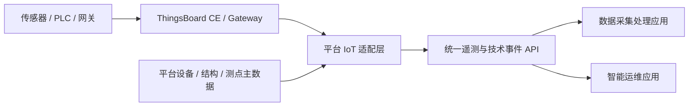
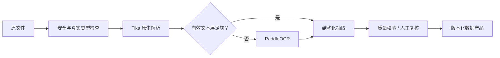

# 08 开源复用开发与测试计划

> 文档状态：Proposed v0.1（技术实施建议，待完成复用验证后冻结）  
> 编制日期：2026-07-29  
> 适用范围：共享底座、数据采集处理应用、智能运维应用、IoT/时序、全员 AI 助手  
> 计划原则：优先复用成熟开源项目，必要时二次开发，只有平台专属领域能力才从零实现

## 1. 结论与使用方式

本项目不采用“找一个开源项目改到能用”的单仓库方案，而采用下列组合：

1. **整库 Fork**：共享管理底座和管理端直接从成熟项目复制，保留完整上游历史，在固定版本上二次开发。
2. **独立部署**：IoT、文档解析、OCR、长流程和 AI 可观测等成熟服务按官方发行版部署，通过平台适配 API 使用。
3. **依赖集成**：认证、工作流、AI Tool Calling、测试等能力使用官方依赖，不复制其仓库。
4. **参考后重写**：两个现有前端原型的业务流程、页面和视觉作为输入，页面可迁移，Mock、认证、数据模型和权限逻辑不复制为生产实现。
5. **领域自研**：设备物理结构、结构模板/实例、部件更换、点位时效映射、双应用数据产品、受控 AI 工具和权威审计必须按本 Spec 实现。

推荐的首期技术基线是：

| 领域 | 推荐项目 | 许可证/注意 | 采用方式 | 首期结论 |
|---|---|---|---|---|
| 共享底座后端 | [RuoYi-Vue-Plus v5.6.2](https://gitee.com/dromara/RuoYi-Vue-Plus/releases/tag/v5.6.2) | MIT，保留声明 | 整库 Fork，固定 `v5.6.2 / 8136a01` | 推荐；先通过 10 个工作日复用验证 |
| 基础管理端 | [plus-ui 5.X](https://github.com/CrazyLionCat/plus-ui) | MIT，资产另扫 | 整库 Fork，固定验证时的精确 commit | 推荐作为共享管理端 |
| 登录与权限原语 | [Sa-Token 1.45.0](https://github.com/dromara/Sa-Token) | Apache-2.0 | 沿用底座依赖 | 首期采用；Keycloak 暂缓 |
| 人工审批 | [Warm-Flow 1.8.5](https://github.com/dromara/warm-flow) | Apache-2.0 | 沿用底座集成和依赖 | 首期采用；业务对象仍由平台保存 |
| IoT/时序 | [ThingsBoard CE](https://github.com/thingsboard/thingsboard) | Apache-2.0 | 官方版本独立部署 | 负责连接、遥测、历史查询和技术规则事件 |
| 工业协议网关 | [ThingsBoard IoT Gateway](https://github.com/thingsboard/thingsboard-gateway) | Apache-2.0 | 官方版本独立部署；私有协议仅扩展连接器 | PLC/Modbus/OPC UA 等按现场需要启用 |
| 文档解析 | [Apache Tika](https://github.com/apache/tika) | Apache-2.0，延续 NOTICE | Tika Server 隔离部署 | 负责真实类型识别、原生文本及元数据抽取 |
| OCR/版面 | [PaddleOCR](https://github.com/PaddlePaddle/PaddleOCR) | Apache-2.0；模型/数据另扫 | 独立 Python 推理服务 | 扫描件、图片、表格和版面抽取 |
| 耐久任务编排 | [Temporal Server](https://github.com/temporalio/temporal) + [Java SDK](https://github.com/temporalio/sdk-java) | Server MIT；Java SDK Apache-2.0 | Server 独立部署，SDK 作为依赖 | 编排解析、OCR、复核、发布等长流程 |
| AI 工具编排 | [Spring AI 1.1.8](https://docs.spring.io/spring-ai/reference/1.1/index.html) | Apache-2.0 | Java 依赖 | 与 Spring Boot 3.5 兼容；实现受控 Tool Calling、模型适配和 RAG |
| AI 可观测/评测 | [Langfuse](https://github.com/langfuse/langfuse) | OSS 主体 MIT；排除未批准的 `ee` 目录 | 可选独立部署 | 只做追踪和评测，不作为权威审计 |
| 业务数据库 | PostgreSQL | PostgreSQL License | 独立数据库/Schema | 共享底座业务数据权威来源 |
| 缓存与会话 | Redis 协议兼容实现 | 产品/版本许可证在 OSS-0 冻结 | 独立部署 | 会话、短期缓存、限流；缓存必须包含租户边界 |
| 对象文件 | S3 兼容接口 | 产品/版本许可证在 OSS-0 冻结 | 先固定接口，产品在部署阶段确定 | 文件正文与业务元数据分离 |

该组合的核心价值不是“代码量最少”，而是让复制范围可追踪、上游可升级、权限和数据权威不分裂。

对象存储首期只冻结 S3 兼容接口和租户对象键规则，不提前把某个产品写成不可替换事实。若候选产品采用强 copyleft 或其他限制性许可证，只允许在专项许可证评审通过后按批准方式使用，不复制或链接其源码。

### 1.1 主选与备选的触发条件

| 当前主选 | 暂缓/备选 | 保持主选的原因 | 何时重新评估 |
|---|---|---|---|
| RuoYi-Vue-Plus 5.6.2 | RuoYi-Vue-Plus 6.x | 6.0 Beta 升级到 Spring Boot 4 且移除原多租户能力，不符合首期简单多租户 | 6.x 恢复并稳定提供所需多租户，且升级收益高于迁移成本 |
| Sa-Token | Keycloak | 当前只有自有应用，沿用底座登录可避免双身份事实源 | 接入 LDAP/AD、OIDC/SAML、强制 MFA 或大量异构应用 |
| Warm-Flow | Flowable | 已随底座集成、轻量且满足首期人工审批 | 必须使用标准 BPMN/DMN、复杂事件或跨系统长期流程 |
| Temporal | Celery、Dagster | Java/Python 跨服务、等待复核、恢复和版本回放更适合耐久工作流 | 任务退化为纯 Python 短队列，或另建离线数仓/数据资产平台 |
| Spring AI 1.1.8 | LangChain4j | 与 RuoYi 的 Spring Boot 3.5 路线一致 | Spring Boot 基线改变或目标模型适配显著不满足 |
| 平台自有 AI 工具层 | Dify | 权限、审计、多租户和自有前端边界可控 | 仅作隔离的单工作区内部原型，并通过许可证专项审查 |

Warm-Flow 和 Temporal 不承担相同职责：前者处理用户审批和业务流转，后者处理跨服务技术任务、重试与恢复。不得让同一业务状态同时由两个引擎决定。

## 2. 已锁定前提与本计划边界

本计划以此前已确认的需求为前提：

- 首期为单部署、共享基础设施的简单逻辑多租户；
- 普通账户首期只属于一个租户；
- 管理组织和物理位置分别建模；
- 两个业务应用共用身份、权限、设备、物理结构、文件、审计和 IoT 数据面；
- 设备分为无实时接入、部分接入和完整接入，不能把“未接入”显示为“离线”；
- ThingsBoard 是 IoT 候选底座，但不是人员、组织、设备物理结构和业务权限的权威来源；
- 当前两个前端项目不迁移 Mock/localStorage 数据；
- 当前智能运维原型的业务能力和工业风格要保留，现有技术实现不约束目标架构；
- 每个登录用户均可使用 AI 助手，AI 查询和操作必须受用户原权限约束，并记录实际用户和完整工具链路。

本文件是实施与验证计划，不替代 00—07 中的业务需求。开源项目只负责加速实现，不改变领域定义和验收口径。

## 3. 开源采用模式与禁止事项

### 3.1 采用模式

| 代码 | 模式 | 适用场景 | 必须保留的治理能力 |
|---|---|---|---|
| `FORK` | 完整 Fork | 需要大量使用并持续定制上游代码 | 上游 remote、固定 commit、许可证/NOTICE、补丁队列、升级回归 |
| `SERVICE` | 独立部署 | 成熟基础设施或专业服务 | 版本/镜像 digest、API 契约、凭据隔离、健康检查、替换适配器 |
| `LIB` | 官方依赖 | 稳定 SDK、框架或测试库 | 锁文件、SBOM、CVE、兼容矩阵、封装边界 |
| `EXTRACT` | 小范围复制 | 官方示例、连接器、薄包装代码 | 原文件映射、版权头、修改说明、局部测试 |
| `REFERENCE` | 仅参考 | 产品流程、交互、算法思路或领域映射 | 不复制表达性代码；在 Spec 中记录参考来源 |
| `CUSTOM` | 平台自研 | 核心领域和权威边界 | 需求、设计、接口、测试和审计完整闭环 |

“直接复制”在本计划中默认指 `FORK` 或经登记的 `EXTRACT`，不允许从网页或多个衍生仓库散拷代码。

### 3.2 禁止事项

- 禁止使用来源不明、无许可证或无法确认权利范围的代码、图片、字体、示例数据和模型权重。
- 禁止删除复制文件中的版权头、许可证和 NOTICE。
- 禁止把 ThingsBoard、Temporal、Langfuse 或 Dify 的管理前端复制到面向业务用户的 Vue 应用。
- 禁止让 ThingsBoard 用户、RuoYi 用户和两个业务应用用户形成三套终端身份。
- 禁止业务前端直接连接 ThingsBoard、Temporal、OCR、数据库、对象存储管理 API 或模型服务。
- 禁止 AI 使用通用 SQL、任意 HTTP、Shell、文件系统或 ThingsBoard 管理/RPC 工具。
- 禁止把流程引擎历史、Langfuse trace 或普通服务日志当作平台权威审计。
- 禁止直接在 RuoYi 核心系统模块中堆叠全部领域代码；新领域使用独立模块和适配接口。
- 禁止从浮动分支或 `latest` 镜像构建生产制品。
- 禁止因“由 AI 生成”而跳过代码来源、许可证、相似代码和安全审查。

许可证默认工程分级：

| 分级 | 类型 | 默认策略 |
|---|---|---|
| A | MIT、BSD、ISC、Apache-2.0 | 可进入技术验证，保留版权、许可证、NOTICE 和修改说明 |
| B | MPL、EPL、LGPL | 条件采用，逐项评估修改、链接和再发布义务 |
| C | GPL、AGPL、SSPL、BSL、Commons Clause、Non-Commercial、无许可证 | 产品代码和运行时默认阻断，必须专项审批 |
| Tool-only | 仅在隔离 CI 中运行、不链接且不随产品分发 | 单独审批，不代表可复制进产品 |

以上是工程准入策略，不构成法律意见；正式对外发布前仍需由项目知识产权责任人确认。

## 4. 开源项目和平台权威边界

### 4.1 共享底座

RuoYi-Vue-Plus 可直接复用的能力：

- 租户、租户套餐的基础管理；
- 用户、部门、岗位、角色、菜单、按钮和部门数据范围；
- Sa-Token 登录、会话、角色/权限校验；
- 字典、参数、公告、在线用户、登录日志、操作日志；
- 文件、定时任务、代码生成和 Warm-Flow 集成骨架。

必须二次开发或替换的能力：

| 平台领域 | 实施方式 | 不能直接沿用的原因 |
|---|---|---|
| 应用目录、租户应用开通 | 新增 `foundation-app` | 租户套餐/菜单不能等同于独立应用授权 |
| 管理组织 | 扩展既有部门模型或提供兼容适配 | 只表达管理关系，不承担物理位置 |
| 物理位置 | 新增 `foundation-location` | 厂区、车间、作业区不能与部门共用一棵树 |
| 人员档案 | 新增 `foundation-person` | 人员可以无登录账户，历史责任关系不能依赖账号生命周期 |
| 设备与物理结构 | 新增 `foundation-asset` | RuoYi 没有结构模板/版本/实例、部件资产和更换历史 |
| 数据源与点位 | 新增 `foundation-iot-control` | 源点位、业务测点、结构绑定需带生效时间 |
| 文件业务关系 | 扩展公共文件元数据和 ACL | 文件需关联设备/结构/部件/业务对象并支持版本 |
| 权威审计 | 新增 `foundation-audit` | 必须记录租户、应用、实际用户、技术身份、前后值和关联操作 |
| AI 治理 | 新增 `foundation-ai` | 工具、确认、审批、会话和模型调用需统一受控 |

RuoYi 的 SQL 租户拦截只覆盖其 ORM 数据访问，不能自动保护 Redis、对象存储、ThingsBoard、时序、搜索/向量、消息、异步任务和 AI 工具。每个数据面均须显式携带并验证租户键。

### 4.2 IoT 与时序



- 平台数据库拥有 `tenantId`、公共设备、物理结构、稳定业务测点和有效期映射。
- ThingsBoard 拥有连接凭据、IoT 侧设备映射、原始遥测、聚合和技术规则事件。
- 建议一个平台租户映射一个 ThingsBoard tenant，保存 `platformDeviceId ↔ tbDeviceId`，但不向终端用户暴露 ThingsBoard 账户。
- 两个业务应用只能通过平台统一 API 查询，不直读 ThingsBoard 数据库。
- 首期 ThingsBoard 使用独立 PostgreSQL；是否增加队列、分片或独立时序组件必须由容量测试触发。
- 设备远程控制首期不开放给 AI；未来也必须经过平台命令 API、重新鉴权、审批和权威审计。

### 4.3 数据处理

数据处理采用双通道：



- Tika Server 放在受限容器内解析不可信文件。
- PaddleOCR 包装成内部无状态服务，不 Fork 主仓库；只在必要时基于官方 Serving 示例实现薄适配层。
- Temporal 保存任务恢复所需的流程状态；平台业务表保存批次、复核、数据产品、实际用户和权威审计。
- Workflow/Activity 的幂等键至少包括 `tenantId + fileId + pipelineVersion + step`。
- 首批黄金链路为检验报告、点巡检记录、故障/维修记录三类。

### 4.4 AI

- Spring AI 只负责模型适配、Tool Calling 和 RAG 组件，不决定最终业务权限。
- 工具目录、授权、确认、审批、幂等和审计由平台实现。
- `tenantId`、`userId`、`roles`、`applicationId` 和数据范围从服务端登录态注入，模型不得填写或修改。
- Langfuse 可异步接收脱敏 trace，用于工程观测和评测；平台审计数据库始终是权威来源。
- Dify 不作为核心底座：其修改版许可证包含未经授权运行多租户环境和前端品牌方面的限制，且其用户/前端体系与本项目冲突。
- Keycloak 仅在出现企业 LDAP/AD、第三方 OIDC/SAML、强制 MFA 或更多异构应用时，以独立身份提供者方式引入。

## 5. 代码库和上游同步结构

建议不要直接在两个原型仓库中建设共享底座，而建立以下代码库：

```text
platform-foundation-server/    # Fork RuoYi-Vue-Plus 5.6.2
platform-foundation-admin/     # Fork plus-ui 5.X
platform-business-web/         # 新建 Vue/TS/Element Plus 工作区
  apps/maintenance/            # 智能运维应用
  apps/data-processing/        # 数据采集处理应用
  packages/ui-kit/             # 工业风格变量、组件和图表规范
  packages/auth-client/        # 统一登录态、应用切换和权限指令
  packages/api-client/         # OpenAPI 生成客户端
platform-data-worker/          # PaddleOCR/抽取等 Python Worker
platform-deploy/               # Compose/Helm、配置、监控和制品清单
```

当前两个原型仓库保持可运行并暂时只读，作为页面迁移和验收对照。业务页面按“先建立真实 API，再迁移页面，再删除 Mock”的顺序进入新工作区。

Fork 分支约定：

```text
upstream/5.6.2   # 不修改的上游基线
vendor/5.x       # 只接收已评审的上游安全/缺陷修复
product/main     # 产品开发主线
feature/*        # 规格对应的短生命周期分支
```

每个 Fork 维护：

- `OPEN_SOURCE_INVENTORY.yaml`
- `THIRD_PARTY_NOTICES`
- `UPSTREAM.md`
- `PATCHES.md`
- `provenance.csv`
- `security-exceptions.yaml`

## 6. Spec 驱动和 AI 辅助开发方式

### 6.1 不只使用单一 Spec

每个可交付功能使用“需求 Spec + 架构决策 + 开源采用记录 + API 契约 + 可执行测试”五件套。建议目录：

```text
specs/<feature-id>/
  requirements.md       # 用户故事、权限、状态、验收场景
  design.md             # 领域模型、时序、失败和审计设计
  oss-adoption.md       # 来源、版本、许可证、采用模式和改动边界
  api/openapi.yaml      # 接口和错误码契约
  tasks.md              # 可独立提交的开发任务
  test-plan.md          # 自动化矩阵、数据和退出标准
  acceptance.md         # 演示脚本和最终结果
```

需求编号必须映射到 API、代码提交、自动化用例和验收结果。P0 需求到测试的映射率必须为 100%。

### 6.2 AI 开发规则

AI 可用于：

- 从已确认 Spec 生成任务草案、DTO、迁移脚本、测试骨架和文档；
- 将两个原型页面迁移到统一组件和真实 API；
- 生成适配器、契约测试、边界值和失败场景；
- 分析 Fork 与上游差异、依赖变更和测试失败；
- 为人工审查生成变更摘要和风险清单。

AI 不可独立决定：

- 租户边界、数据权威、权限等级和 AI 高风险操作；
- 开源许可证是否可用；
- 删除版权、NOTICE、审计字段或安全校验；
- 把模拟算法结果直接变成生产结论；
- 在没有黄金数据和验收阈值时宣称 OCR、诊断或 LLM 能力完成。

每个 AI 生成的变更必须满足：

1. 输入中引用精确需求编号和精确上游 tag/commit；
2. 小批量生成，一次只完成一个可验证任务；
3. 先运行上游/特征基线测试，再修改；
4. 生成代码经过人工评审、相似来源扫描、静态检查和自动化测试；
5. 安全关键代码由另一名开发者复核；
6. 提交说明记录 AI 参与、采用来源和测试结果。

## 7. 分阶段开发计划

下面工期是人日估算，不是自然日承诺。完整范围按 6 人左右团队可在约 20—26 周并行推进；3 人团队约 35—48 周。容量、真实算法和现场协议未冻结前保留约 20% 风险缓冲。

| 阶段 | 建议自然周 | 估算人日 | 主要结果 | 退出门禁 |
|---|---:|---:|---|---|
| OSS-0 复用验证 | 1—2 | 15—20 | 候选固定、原版可构建、租户/UI/IoT/OCR/AI 薄 PoC | OSS-G0—G2 |
| F0 底座骨架 | 3—5 | 35—45 | Fork 底座、统一登录、租户、应用开通、API/审计骨架 | DEV-G1 |
| F1 共享管理 MVP | 6—10 | 55—75 | 组织/位置/人员/权限、设备结构、文件、统一前端壳 | DEV-G2 |
| D1/D2 数据闭环 | 11—15 | 45—65 | 采集、Tika/OCR、复核、三类数据产品 | DEV-G3-D |
| I1 IoT/时序 | 11—15，可与 D 并行 | 35—50 | ThingsBoard/Gateway、点位映射、统一时序 API | DEV-G3-I |
| O1 智能运维 | 14—21 | 65—90 | 原型页面迁移、核心业务闭环、Mock 退场 | DEV-G4-O |
| A1/A2 AI 助手 | 17—22 | 35—50 | 只读查询、RAG、录入草稿、确认写入和完整审计 | DEV-G4-A |
| REL 发布加固 | 23—26 | 25—40 | 性能、安全、恢复、供应链、灰度和回滚 | DEV-G5 |
| **合计** | — | **310—435** | 基础平台与两个业务应用 MVP | — |

### 7.1 OSS-0：10 个工作日复用验证

| 任务 | 开发/验证内容 | 产物 | 通过标准 |
|---|---|---|---|
| OSS-DEV-001 | 为每个候选建立 OSS-INTAKE；记录官网、仓库、tag、commit、SHA-256、SPDX、NOTICE、资产/模型许可证 | 组件清单和准入记录 | 无未知来源或未批准许可证 |
| OSS-DEV-002 | 原样构建 RuoYi-Vue-Plus 5.6.2 和 plus-ui；运行上游测试并生成行为快照 | 可重复构建脚本、原版报告 | 原版基线可重复构建 |
| OSS-DEV-003 | 双租户、同名用户、双应用开通、部门数据范围和平台支持访问 PoC | 租户隔离报告 | 无跨租户可见；未开通应用被拒绝 |
| OSS-DEV-004 | plus-ui 管理端与工业风格业务壳并行运行，验证统一登录和应用切换 | 前端薄切片 | 不强制混合两个原型的依赖 |
| OSS-DEV-005 | ThingsBoard CE/Gateway 接入模拟点和历史查询，验证平台 ID 映射 | IoT 薄切片 | 两租户、同编码设备不串数据 |
| OSS-DEV-006 | Tika + PaddleOCR 解析三类真实样本，建立首版黄金集 | OCR 基线 | 每个字段可定位原始证据 |
| OSS-DEV-007 | Temporal 执行“上传→解析→复核→发布”最小流程并强制重启 Worker | 任务恢复报告 | 重试不重复产物，能从等待复核恢复 |
| OSS-DEV-008 | Spring AI 调用一个只读设备工具和一个需确认的草稿工具 | AI 薄切片 | 用户权限、确认和审计链完整 |

若下列任一项失败，不进入正式 Fork 定制：

- RuoYi 多租户无法覆盖确认的基础场景；
- plus-ui 改造成本高于新建管理壳的估算；
- 关键组件许可证、模型权重或前端资产不能通过准入；
- ThingsBoard 在批准容量画像下无法满足写入/查询目标；
- 核心依赖存在无可行缓解的严重安全风险。

### 7.2 F0：共享底座骨架

开发任务：

- `F0-DEV-001`：建立 Fork、上游 remote、补丁清单、自动构建、SBOM 和镜像签名链。
- `F0-DEV-002`：裁剪示例业务和演示数据，保留系统管理、租户、权限、字典、文件和工作流基础模块。
- `F0-DEV-003`：实现租户编码 + 用户名 + 密码登录，普通账户只允许一个有效租户成员关系。
- `F0-DEV-004`：实现应用目录、租户应用开通、用户应用权限和同登录态应用切换。
- `F0-DEV-005`：统一 API 错误、分页、幂等键、traceId、服务身份和 OpenAPI。
- `F0-DEV-006`：扩展审计骨架，保存 `tenantId/applicationId/userId/technicalIdentity/traceId`。
- `F0-DEV-007`：封装平台管理员限时支持模式，默认无权读取租户业务数据。

测试重点：

- 相同用户名分别存在于租户 A/B 时正确登录且不串租户；
- 停用租户、停用账户、未开通应用、撤销权限立即生效；
- 修改 URL、Header、Body 中的 `tenantId` 不能切换租户；
- 登录、退出、令牌过期、Redis 重启、并发登录和重复提交；
- 平台支持模式的原因、范围、有效期和实际人员全程审计；
- 原版 Fork 基线和本地新增模块分别可构建、可回滚。

### 7.3 F1：共享管理 MVP

开发任务：

- `F1-DEV-001`：管理组织、物理位置两棵独立树及授权关系。
- `F1-DEV-002`：人员档案和登录账户分离，维护责任人和历史身份快照。
- `F1-DEV-003`：角色、菜单、按钮、应用、组织/位置/设备/字段数据范围的服务端授权。
- `F1-DEV-004`：设备主档及“无实时/部分/完整接入”独立状态。
- `F1-DEV-005`：物理结构模板、模板版本、设备实例、实例偏差和升级预览。
- `F1-DEV-006`：结构位置和可更换部件资产分离，保存拆装生效时间。
- `F1-DEV-007`：通用文件、版本、ACL、结构关联、预览/下载和保留策略。
- `F1-DEV-008`：统一管理端和业务应用壳，包括设计变量、导航、权限指令、应用切换、设备选择器和 AI 入口。

测试重点：

- 组织和位置不可混用，二者授权组合结果正确；
- 结构模板发布后不可静默覆盖，实例升级需预览差异；
- 有数据/文件引用的节点不能无审计删除；
- 换件前后记录按有效时间归属正确；
- 文件列表、临时下载 URL、缓存、导出和搜索均按租户/ACL 隔离；
- 共享管理端与两个空业务应用复用同一账户，但未授权菜单和接口同时被拒绝。

### 7.4 D1/D2：数据采集处理闭环

开发任务：

- `D-DEV-001`：数据分类、采集模板/版本、Schema/版本和处理管线版本。
- `D-DEV-002`：采集批次、批量上传、历史日期、无数据声明、逐文件结果和幂等。
- `D-DEV-003`：Tika Server 安全适配、真实文件类型和原生文本抽取。
- `D-DEV-004`：PaddleOCR 推理服务、版面/表格结果和原文坐标证据。
- `D-DEV-005`：Temporal Workflow/Activity、失败重试、等待人工复核、取消和补偿。
- `D-DEV-006`：字段抽取、单位/字典标准化、置信度、人工修正和完整血缘。
- `D-DEV-007`：发布检验报告、点巡检记录、故障/维修记录三类不可变数据产品。
- `D-DEV-008`：为智能运维提供正式查询 API 和可靠发布/替代/撤回事件。

测试重点：

- 伪造扩展名、加密/损坏/超大文件、压缩炸弹、超时和内存限制；
- OCR 黄金集覆盖旋转、模糊、污渍、盖章、合并单元格和多页；
- 每一步杀死 Worker 后任务可恢复且不重复产物；
- 低置信/冲突/敏感字段不经复核不能发布；
- 人工修正保留原值、修正值、人员和原因；
- 运维应用只能读取发布数据产品，不能读取 ETL 私有任务表。

### 7.5 I1：IoT 与时序底座

开发任务：

- `I-DEV-001`：数据源、接入模板、源点位、稳定业务测点及带生效时间的映射。
- `I-DEV-002`：平台租户/设备与 ThingsBoard tenant/device 的映射和补偿同步。
- `I-DEV-003`：Gateway 接入共享 PLC，支持一个 PLC 服务多台设备。
- `I-DEV-004`：统一最新值、历史、聚合、质量、新鲜度和技术规则事件 API。
- `I-DEV-005`：分别计算接入生命周期、数据运行状态、覆盖率和设备业务状态。
- `I-DEV-006`：技术事件到运维业务告警的幂等关联，不共用状态机。

测试重点：

- 重复、乱序、延迟、缺失、未来时间戳、QoS 重投和未知点位；
- Gateway 断网缓存、重连补传、服务重启和数据库短断；
- 源点位地址变化或部件更换后，历史仍按当时映射归属；
- 无实时接入设备可正常使用巡检、检验、文件和维修；
- 同一测点在两个应用显示相同值、时间和质量；
- AI 或普通用户绕过平台直接调用 RPC 必须失败。

### 7.6 O1：智能运维原型迁移

迁移遵循“保留业务意图，不保留 Mock 权威”的原则：

| 当前原型模块 | 目标实现 | 开源复用 | 迁移/验收重点 |
|---|---|---|---|
| 登录、场景、设备列表和详情 | 共享登录、授权范围、真实设备 API | RuoYi/plus-ui + 原型页面参考 | 直接地址越权拒绝，统计和列表同范围 |
| 安全监控 | 真实点位、最新值、循环和告警 | ThingsBoard API + 原型组件迁移 | 未接入/无数据/延迟分别展示 |
| 健康监测 | 结构节点、测点、图像和覆盖率 | ThingsBoard + 文件服务 | 实测、仿真、人工和 AI 来源可区分 |
| 点巡检智能 | 计划、任务、记录、异常和结构化草稿 | Warm-Flow 可用于审批；领域自研 | 自然语言草稿确认后入库 |
| 检验智能 | 周期、报告、到期规则和不合格项 | Tika/PaddleOCR + Warm-Flow | 报告真实预览下载，范围正确 |
| 健康评估 | 版本化输入、规则/算法结果和证据 | 任务框架复用，算法接口自研 | 数据不足不得输出无条件正常 |
| 裂纹预测 | 模型任务、输入窗口、不确定性和复核 | 仅复用任务/观测基础设施 | 无真实模型时明确待接入，不保留模拟结论 |
| 故障诊断 | 减速机、制动器、车轮诊断结果 | 文件/OCR/任务框架，算法接口自研 | 结果可追溯模型版本和证据 |
| 风险定量评估 | 版本化指标、取值来源、评分和整改 | Warm-Flow 处理后续闭环 | 原型 15 指标不写死 |
| 维修智能 | 来源、工单、维修、部件和停机 | Warm-Flow + 领域自研 | 告警/巡检/诊断到工单来源链 |
| 基础数据 | 共享设备权威主档和统计 | RuoYi 基础框架 + 设备领域 | 删除独立 60 台模拟台账 |
| 供给 | 制造商、供应商、部件和资料 | 文件/设备领域 | 删除独立 24 条模拟台账 |
| 三类知识库 | 版本化知识、检索、引用和权限 | Tika + Spring AI；向量层适配 | 失效版本不用于新结论 |
| 隐患/问题处理 | 统一问题、分派、整改、复查和关闭 | Warm-Flow + 领域状态机 | 业务表是权威，流程实例只保存流转 |

每个页面迁移任务依次完成：

1. 固定当前原型截图和交互基线；
2. 对应 Spec 和 OpenAPI 就绪；
3. 页面接入真实 API；
4. 增加加载、空数据、无权限、未接入、延迟和部分失败状态；
5. 完成功能、视觉和权限自动化；
6. 删除对应 Mock；未接入算法的入口明确禁用或标记待接入。

### 7.7 A1/A2：全员 AI 助手

开发任务：

- `A-DEV-001`：模型网关和 Provider 接口，支持云/私有模型路由及脱敏策略。
- `A-DEV-002`：工具注册表、版本、应用范围、角色/数据范围和风险级别。
- `A-DEV-003`：只读工具：设备/结构、遥测、文件、数据产品、巡检/检验/维修和知识检索。
- `A-DEV-004`：检索前 ACL、来源引用和撤权后的缓存/会话重新鉴权。
- `A-DEV-005`：R2 两阶段写入：生成草稿→展示具体影响→用户确认→重新鉴权→幂等执行。
- `A-DEV-006`：R3 只生成申请，接入 Warm-Flow、重新认证和发起/审批人分离。
- `A-DEV-007`：权威 AI 审计及与 Langfuse 脱敏 trace 的关联。
- `A-DEV-008`：租户/用户额度、速率、超时、降级和成本指标。

测试重点：

- 按“租户×应用×角色×组织/位置/设备范围×工具×风险等级”生成权限矩阵；
- 直接询问、换说法、要求汇总/导出均不能泄露无权数据；
- 文档间接提示注入不能改变系统规则或触发工具；
- 写工具参数、确认内容和有效期绑定，确认后再次鉴权；
- 重放、超时、非法 JSON、模型拒绝、工具部分失败保持幂等和一致状态；
- 任一写操作可从实际用户请求追溯到模型、Prompt、工具、确认、业务 API、前后值和最终响应。

## 8. 测试总体方案

### 8.1 测试环境

| 环境 | 用途 | 数据和依赖 |
|---|---|---|
| Local | 单元、组件、适配器开发 | 临时 PostgreSQL/Redis，模拟外部模型 |
| CI-PR | 变更快速验证 | Testcontainers、固定上游基线、小型黄金集 |
| CI-Nightly | 完整集成和隔离 | 三租户、ThingsBoard、Temporal、Tika、OCR、浏览器 |
| Staging | 性能、安全、恢复、UAT | 接近生产拓扑、脱敏/合成数据、固定容量画像 |
| Production Canary | 上线烟雾和灰度 | 只读/低风险哨兵数据，禁止使用测试租户访问真实租户 |

固定测试租户：

- 租户 A、B 使用相同用户名和相同设备业务编号；
- 租户 C 为停用租户；
- 平台管理员默认不属于任何业务租户；
- A 只开通一个业务应用，B 开通两个应用，以验证应用授权。

### 8.2 开源测试工具基线

| 类别 | 推荐工具 | 用途 |
|---|---|---|
| Java 单元/集成 | JUnit、Testcontainers、REST Assured | 领域、真实 PostgreSQL/Redis、API |
| Vue 单元/组件 | Vitest、Vue Test Utils | 组件、Store、权限指令 |
| 浏览器 E2E | Playwright | Chromium/Firefox/WebKit、Trace、视觉回归 |
| API 契约/模糊 | OpenAPI、Pact、Schemathesis | 消费者契约、边界值、非法状态 |
| OSS/许可证 | ScanCode Toolkit | 源码许可证、版权和来源扫描 |
| SBOM/漏洞 | Syft、Trivy、OSV-Scanner | CycloneDX SBOM、依赖/镜像/CVE/配置 |
| 供应链签名 | Cosign | 镜像、SBOM 和证明按 digest 签名 |
| Web 安全 | OWASP ZAP | 基线和认证后动态扫描 |
| 性能 | Apache JMeter、Locust | HTTP/数据库及自定义 IoT/OCR 负载 |
| 网络故障 | Toxiproxy | 延迟、断连、限速和连接重置 |
| MQTT 驱动 | Eclipse Mosquitto clients | 设备模拟、重复/乱序/断网测试 |
| AI 评测 | Promptfoo（仅隔离测试环境） | 权限、注入、结构、引用和红队用例 |

所有测试工具也要进入 Tool-only 清单。默认不把 AGPL 测试工具代码嵌入或分发到产品。

### 8.3 分层测试矩阵

| 层级 | 主要对象 | 最低要求 |
|---|---|---|
| 上游原版基线 | Fork 前的原仓库 | 原测试 100% 运行并保存结果；无法运行项逐条说明 |
| 特征/差分测试 | 即将修改的开源行为 | 修改前建立行为快照，修改后说明每个差异 |
| 单元测试 | 领域规则、权限、状态、幂等 | 新增代码行覆盖≥80%、分支≥70% |
| 安全关键单元 | 租户、授权、设备绑定、AI 工具 | 行覆盖≥90%、分支≥80% |
| 集成测试 | PostgreSQL、Redis、对象、TB、Temporal、OCR | 使用真实协议/容器，不以 H2 代替 PostgreSQL验收 |
| API/契约 | 三个前端、外部适配器 | 已使用 API 100% 有契约测试 |
| E2E | 用户关键业务闭环 | Critical 流程 100% 通过 |
| 专项 | 租户、IoT、OCR、AI、安全、性能、恢复 | 专项退出标准全部满足 |
| UAT | 业务人员按 Spec 验收 | P0 场景 100% 通过并留存结果 |

### 8.4 多租户隔离矩阵

下列资源均须执行列表、详情、创建、修改、删除、搜索、统计、导出和猜测 ID 测试：

- 组织、位置、人员、账户和角色；
- 设备、结构、部件、数据源和点位；
- 文件、临时下载 URL 和对象 Key；
- 时序、技术事件、业务告警和工作循环；
- 采集批次、任务、OCR 结果和数据产品；
- 缓存、消息、异步任务和定时任务；
- 搜索/向量索引、AI 会话、工具和审计。

退出标准：

- 隔离矩阵 100% 通过；
- 任何一次跨租户可见、统计泄露、存在性泄露或写入均按最高等级缺陷阻断发布；
- 客户端提供的 `tenantId` 永远不能替代服务端登录上下文；
- 平台支持模式之外，平台管理员不能读取租户业务正文。

### 8.5 IoT/时序容量与可靠性

容量配置保存在版本化 `capacity-profile`：

```text
R_peak = 实时设备数 × 每设备有效点数 × 每秒采样次数
持续负载 = 1.0 × R_peak，8 小时
容量负载 = 1.5 × R_peak，30 分钟
突发负载 = 2.0 × R_peak，5 分钟
补传负载 = 峰值写入 + 批准的断网积压恢复
```

必须验证：

- 业务定义范围内零数据丢失、零跨租户；
- 重复消息不重复产生业务告警/工单；
- 乱序数据按时间和质量规则可解释；
- Gateway 恢复后的积压在批准时间内清空；
- 最新值、时间范围、聚合和长周期查询满足 05 文档 SLO；
- 单租户高频写入和大查询不造成其他租户无界退化。

### 8.6 OCR 和数据产品质量

每个黄金样本保存原文件哈希、人工真值、引擎/模型版本、预处理参数、Schema、字段证据和人工复核结果。至少统计：

- 字符错误率；
- 关键字段精确率、召回率和完全正确率；
- 表格单元格/合并关系正确率；
- 自动通过、需复核和失败比例；
- 单页耗时、任务排队和资源峰值。

首版阈值由 OSS-0 的真实样本基线冻结。后续版本：

- 关键指标不得无批准下降超过 2 个百分点；
- 关键字段低置信时不得自动发布；
- 人工确认后的发布值必须与确认值完全一致；
- 重跑生成新执行/结果版本，不覆盖原始证据。

### 8.7 AI 质量、安全和审计

AI 测试不依赖回答的精确措辞，断言：

- 返回结构和引用是否有效；
- 查询范围是否在当前用户权限内；
- 选择的工具及参数是否允许；
- 写操作是否进入正确确认/审批级别；
- 实际用户、技术身份和审计链是否完整；
- 模型/Prompt/工具版本变化是否造成指标退化。

采用“金丝雀”隔离测试：在不同租户文档中放入不同的测试标记，任何跨租户检索命中立即阻断发布。Prompt 注入、越权请求、参数篡改、确认过期、重放和模型/工具故障均纳入固定黄金集。

权威审计完整率必须为 100%；Langfuse 停机、丢 trace 或保留期变化不能影响平台审计和人工业务。

## 9. CI/CD 和质量门禁

### 9.1 开源准入门禁

| 门禁 | 时点 | 必须产物 | 阻断条件 |
|---|---|---|---|
| OSS-G0 候选立项 | 下载/复制前 | 需求映射、官方来源、采用模式、初步许可证 | 来源不明、无许可证、核心需求不匹配 |
| OSS-G1 合规准入 | PoC 前 | 完整扫描、NOTICE、资产/模型许可证、SBOM | 未批准限制性许可证、未知许可证、NOTICE 缺失 |
| OSS-G2 原版基线 | 修改前 | 可重复构建、上游测试、CVE/秘密扫描、行为快照 | 原版无法构建、关键测试失败、严重风险未评估 |
| OSS-G3 定制开发 | 每个 PR | 来源映射、修改标记、本地/契约/回归测试 | 复制来源不可追踪、版权被删除、关键回归失败 |
| OSS-G4 发布候选 | 发布前 | 完整 SBOM、签名、全回归、性能/安全/隔离报告 | 发布退出条件不满足 |
| OSS-G5 上游升级 | 每次同步 | License/SBOM/API 差异、补丁重放、差分回归、回滚包 | 许可证变化未复审、补丁丢失、行为不可接受 |

### 9.2 开发阶段门禁

| 门禁 | 允许进入下一阶段的条件 |
|---|---|
| DEV-G1 F0 | 登录、租户、应用开通和审计闭环；三租户隔离用例 100% 通过 |
| DEV-G2 F1 | 共享主数据、设备结构、文件和权限完成；两个空业务应用复用同一身份 |
| DEV-G3-D | 三类文件形成可追溯数据产品；失败恢复、人工复核和发布契约通过 |
| DEV-G3-I | 共享 PLC、点位映射、历史查询、断网补传和双应用一致性通过 |
| DEV-G4-O | 当前原型纳入范围的页面均使用真实 API；无误导性 Mock/占位操作 |
| DEV-G4-A | AI 无越权查询/工具调用；写操作确认和实际用户审计完整率 100% |
| DEV-G5 | 功能、隔离、IoT、OCR、AI、安全、性能、恢复、SBOM 和回滚全部达标 |

### 9.3 执行频率

每个 PR：

- 来源和许可证增量检查、秘密扫描；
- 前端类型/Lint/单元测试，后端单元测试；
- 变更覆盖率、OpenAPI 破坏性检查、契约测试；
- 租户/权限安全单元测试；
- 构建、增量 SBOM/CVE。

每晚：

- 完整集成、Playwright Chromium E2E；
- 三租户隔离矩阵；
- OpenAPI 模糊测试；
- IoT 乱序/重复/断网恢复；
- OCR 和 AI 黄金集快速子集；
- ZAP 基线、完整 SBOM/CVE/许可证扫描。

每周：

- 三浏览器 E2E 和视觉回归；
- IoT 峰值、故障注入和 8 小时浸泡；
- OCR 全量黄金集；
- AI 全量评测和红队；
- 备份恢复抽查；
- 上游安全公告、许可证、NOTICE 和版本变化检查。

发布候选：

- 干净环境可重复构建；
- 全量功能、契约、E2E 和专项测试；
- 认证后 DAST、安全和供应链报告；
- 数据库升级/回滚、备份恢复、灰度/回滚演练；
- 最终源码和镜像 SBOM、NOTICE、漏洞例外和签名。

### 9.4 统一发布退出标准

- P0 需求到测试映射和用例通过率 100%；
- Critical 业务流 E2E 100% 通过，总体自动化通过率不低于 98%；
- 多租户、权限和 AI 工具授权用例 100% 通过；
- 无未解决的最高/高等级功能、安全或数据缺陷；
- 无来源不明、无许可证或未经批准的限制性组件；
- 无可利用的 Critical/High 漏洞；例外必须有可达性证据、补偿措施、负责人和到期日；
- NOTICE、版权和修改声明完整，SBOM 与最终制品 digest 一致并签名；
- 上游原测试和本地 Fork 回归全部通过；
- IoT 测试范围内零数据丢失、零跨租户、业务去重正确；
- OCR 不低于批准基线，低置信字段不自动发布；
- AI 无跨租户检索、无越权工具调用，权威审计完整率 100%；
- 性能、浸泡、故障恢复、迁移、备份和回滚实际演练通过；
- 最近 20 次夜间运行 flaky rate 低于 1%，关键用例不得跳过。

## 10. 上游升级和退出策略

每次 Fork 升级必须：

1. 构建新上游原版并运行其原测试；
2. 比较许可证、NOTICE、依赖、SBOM 和安全公告；
3. 比较数据库迁移、OpenAPI、消息、配置和前端路由；
4. 逐个重放本地补丁，不夹带新业务需求；
5. 对旧 Fork 和新 Fork 运行同输入差分测试；
6. 重跑租户、权限、IoT、OCR、AI 和全业务回归；
7. 比较性能；核心指标退化超过 10% 必须分析和批准；
8. 灰度并验证一步回滚；
9. 更新 `UPSTREAM.md`、`PATCHES.md` 和组件清单。

任一外部服务都通过平台适配器接入。若 ThingsBoard、Tika、Temporal、OCR 或模型供应商需要替换，业务 API、公共设备 ID、审计和数据产品不随之改变。

## 11. 团队分工建议

6 人参考配置：

| 角色 | 数量 | 主要责任 |
|---|---:|---|
| 技术负责人/架构 | 1 | Spec、领域边界、上游策略、接口和门禁 |
| Java/平台后端 | 2 | RuoYi Fork、共享领域、权限、IoT/AI 适配 |
| 前端 | 1—2 | plus-ui 管理端、业务壳、原型页面迁移 |
| 数据/Python | 1 | Tika/OCR、抽取、黄金集和数据产品 |
| 测试/DevSecOps | 1 | 自动化、租户专项、供应链、性能和发布 |

测试职责不只属于测试角色：每个开发任务必须同时提交自动化用例和来源记录；安全关键变更必须双人复核。

## 12. 立即执行的两周清单

如果用户确认本建议，第一批只做 OSS-0，不立即大规模迁移业务页面：

1. 建立 5 个目标代码库和 OSS 清单模板；
2. Fork 并固定 RuoYi-Vue-Plus 5.6.2/plus-ui 精确版本；
3. 在原版未修改状态完成可重复构建、测试、SBOM 和许可证扫描；
4. 完成租户 A/B/C、双应用和平台支持访问 PoC；
5. 完成一个统一登录和应用切换的前端薄切片；
6. 完成 ThingsBoard 单点写入、历史查询、双租户和共享 PLC 模拟；
7. 使用真实脱敏样本建立三类文档黄金集；
8. 完成 Tika/PaddleOCR/Temporal 最小链路；
9. 完成 Spring AI 只读工具、确认草稿工具和实际用户审计；
10. 在第 10 个工作日召开门禁评审，输出“采用、替换或延后”结论和更新后的精确工期。

## 13. 本轮需要确认

本计划可以先按推荐值进入 OSS-0；正式定版前只需要确认：

1. 是否同意以 **RuoYi-Vue-Plus 5.6.2 + plus-ui** 作为底座 Fork 验证对象；
2. 是否同意首期保留 **Sa-Token + Warm-Flow**，暂不引入 Keycloak/Flowable；
3. 是否同意以 **Temporal** 统一编排跨 Java/Python 的长流程；
4. 是否接受 **Dify 不作为核心平台**，AI 使用 Spring AI + 平台自有工具/审计；
5. 是否可以提供三类真实脱敏文档，用于冻结 OCR/结构化质量基线；
6. 预计设备、实时接入比例、点位和采样频率，用于冻结 ThingsBoard 容量画像。
