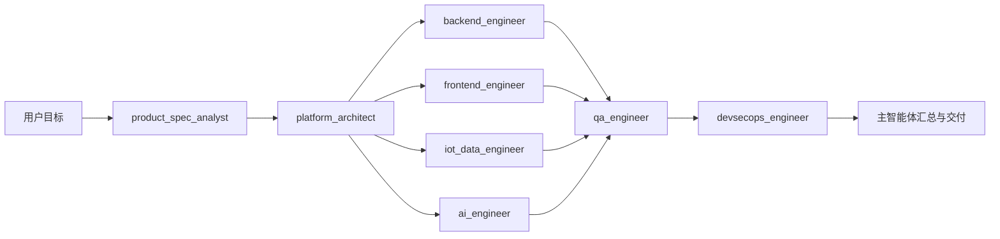

# 09 多智能体开发协作方案

> 文档状态：Active v0.1  
> 编制日期：2026-07-29  
> 配置位置：`.codex/config.toml`、`.codex/agents/*.toml`  
> 组织原则：按研发岗位分工，不按临时业务模块重复创建智能体

## 1. 目标

本方案把 AI 辅助开发组织成一支岗位明确的研发团队。主智能体负责理解用户目标、拆分任务、分配写入范围、合并结论和最终交付；项目级自定义智能体负责各自专业岗位。

智能体不是独立的数据或权限系统，也不是生产环境中的“业务 AI 助手”。它们只用于本项目的需求、设计、开发、测试和发布工作。

## 2. 开发角色

| 角色智能体 | 研发岗位 | 主要职责 | 默认写入范围 |
|---|---|---|---|
| `product_spec_analyst` | 产品经理/需求分析师 | 澄清需求、维护 Spec、角色权限、流程、优先级和验收追踪 | 已分配的 Spec/需求文档 |
| `platform_architect` | 平台架构师 | 领域边界、数据权威、ADR、接口依赖、非功能和阶段门禁 | 默认只读，向主智能体交付设计结论 |
| `backend_engineer` | 后端工程师 | RuoYi Fork、共享底座、业务 API、租户/IAM、设备结构、文件、工作流和审计 | 指定后端仓库/模块 |
| `frontend_engineer` | 前端工程师 | Vue 管理端与业务应用、设计系统、真实 API 接入和原型页面迁移 | 指定页面、组件或共享前端包 |
| `iot_data_engineer` | IoT/数据工程师 | ThingsBoard/Gateway、时序、点位映射、Tika/OCR/Temporal 和数据产品 | 指定 IoT/数据服务或适配模块 |
| `ai_engineer` | AI 工程师 | Spring AI、RAG、受控工具、确认审批、实际用户审计和 AI 安全 | 指定 AI 网关/工具/评测模块 |
| `qa_engineer` | QA/测试工程师 | 单元、集成、契约、E2E、多租户、IoT、OCR、AI、性能和恢复测试 | 测试、Fixture、测试报告 |
| `devsecops_engineer` | DevSecOps 工程师 | 开源供应链、CI/CD、环境、扫描、制品、可观测、灰度和回滚 | 部署、流水线、扫描和制品配置 |

所有角色均服从 00—08 Spec、仓库 `AGENTS.md` 和用户当前请求。角色配置不固定模型，默认继承主任务所选模型；各文件只设置与岗位复杂度匹配的推理强度和工作区权限。

## 3. 标准协作流水线



标准顺序：

1. 产品/需求智能体把用户请求映射到需求编号、对象×动作权限和验收场景。
2. 架构智能体确认数据权威、依赖方向、API/事件边界和非功能门禁。
3. 主智能体把工作拆为互不覆盖的开发任务，后端、前端、IoT/数据和 AI 角色可并行。
4. QA 独立验证需求、契约、负向权限和端到端行为，不通过修改业务实现来“让测试通过”。
5. DevSecOps 验证来源、许可证、SBOM、CVE、构建、部署、备份、灰度和回滚。
6. 主智能体合并结果，处理跨角色冲突，并向用户报告完成项、证据和未决风险。

小型任务可以跳过不相关角色；不得为了“使用所有智能体”而增加无价值的并行工作。

## 4. 写入范围与并行冲突规则

项目配置最多允许 3 个子智能体并行，不代表 8 个角色同时启动。

每个写任务在启动前必须由主智能体分配：

```text
TASK_ID:
ROLE:
SPEC_REFS:
GOAL:
WRITE_SCOPE:
READ_SCOPE:
OUT_OF_SCOPE:
DEPENDENCIES:
REQUIRED_TESTS:
HANDOFF_TO:
```

强制规则：

- 同一时刻，一个文件只能有一个写入角色。
- `WRITE_SCOPE` 不得使用含糊的“整个仓库”；必须是明确目录或文件集合。
- 架构智能体默认只读；需要更新 ADR 时，由主智能体指定单独文档。
- 产品智能体不修改应用代码；QA 不修改业务实现；DevSecOps 不降低安全和质量门禁。
- 后端、IoT/数据和 AI 的专业逻辑通过正式接口交接，不能直接修改对方私有表或绕过领域 API。
- 前端工作开始前必须确认 OpenAPI 或 Mock 契约；正式验收前必须删除该切片对应的生产 Mock。
- 多个智能体共享工作区，发现未归属的本地修改时必须保留，不能覆盖、回退或顺手格式化。
- 当前仓库仍是前端原型；后端、IoT 和 AI 服务只能写入用户明确指定的目标仓库。没有目标仓库时，只能产出 Spec、契约或获准的前端适配。

以下共享热点文件默认串行修改，除非主智能体把它们进一步拆为互不重叠的所有权：

- `.codex/**`、`AGENTS.md` 和 `specs/**`
- `package.json`、锁文件、TypeScript/Vite 配置和路由入口
- 全局样式、共享类型、OpenAPI 根文件、数据库总迁移清单和 CI 主流程

## 5. 角色交接标准

每个智能体完成任务时必须返回：

```text
任务与角色：
覆盖的 Spec/DEC：
完成内容：
修改文件：
API/Schema/事件变化：
权限、租户和审计影响：
执行的测试及结果：
未决风险：
下一交接角色：
```

开发角色不得只回复“已完成”；QA 和 DevSecOps 必须给出实际测试或扫描证据。未运行的检查要明确写成“未运行”及原因。

## 6. 推荐调用方式

单角色任务：

```text
让 product_spec_analyst 把这项需求整理成可验收 Spec，不修改代码。
```

```text
让 frontend_engineer 迁移设备详情页，只允许修改 src/views/device 和对应测试，完成后交给 qa_engineer 验证。
```

并行开发：

```text
先让 platform_architect 确认该切片的数据权威和接口。
然后并行启动 backend_engineer 与 frontend_engineer，分别使用互不重叠的 WRITE_SCOPE。
等待两者完成后，再让 qa_engineer 运行契约和端到端测试，最后由主智能体汇总。
```

开源引入：

```text
让 devsecops_engineer 核验候选项目的官方版本、许可证、SBOM 和安全风险；
让 platform_architect 独立评审它是否破坏现有领域边界。
两者均通过后，才能交给对应开发工程师实施。
```

## 7. 与开源开发计划的对应关系

| 08 文档阶段 | 主责角色 | 配合角色 |
|---|---|---|
| OSS-0 | `devsecops_engineer` | 架构、后端、IoT/数据、AI、QA |
| F0/F1 | `backend_engineer` | 产品、架构、前端、QA、DevSecOps |
| D1/D2 | `iot_data_engineer` | 后端、前端、QA、DevSecOps |
| I1 | `iot_data_engineer` | 后端、前端、QA、DevSecOps |
| O1 | `frontend_engineer` + `backend_engineer` | 产品、架构、IoT/数据、QA |
| A1/A2 | `ai_engineer` | 后端、前端、IoT/数据、QA、DevSecOps |
| REL | `devsecops_engineer` + `qa_engineer` | 全部开发角色 |

## 8. 启用和检查

Codex 从项目根目录的 `.codex/agents/` 读取项目级自定义智能体，`.codex/config.toml` 控制并发数量。若当前已打开的任务尚未发现新角色，重新载入项目或开启一个新的 Codex 任务后再调用。

主智能体仍是唯一的最终协调者。自定义角色只在被分配具体任务时启动，不常驻运行，也不自动获得超出当前任务权限的访问能力。

当前 `.codex/config.toml` 已按本机 `codex-cli 0.142.5` 的配置格式验证。以后升级 Codex 时，需要重新执行配置加载与一次最小角色调用；若新版配置字段发生变化，先迁移配置再允许团队任务并行执行。
